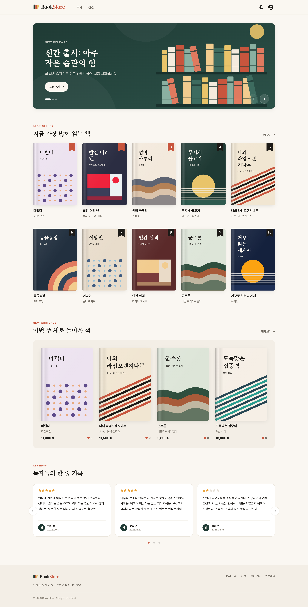
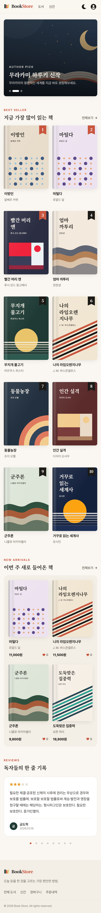
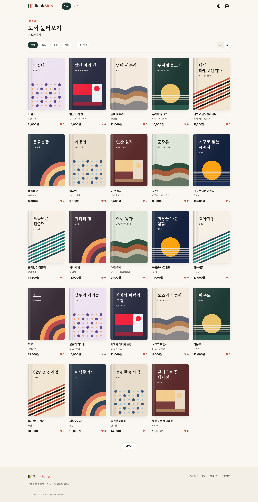
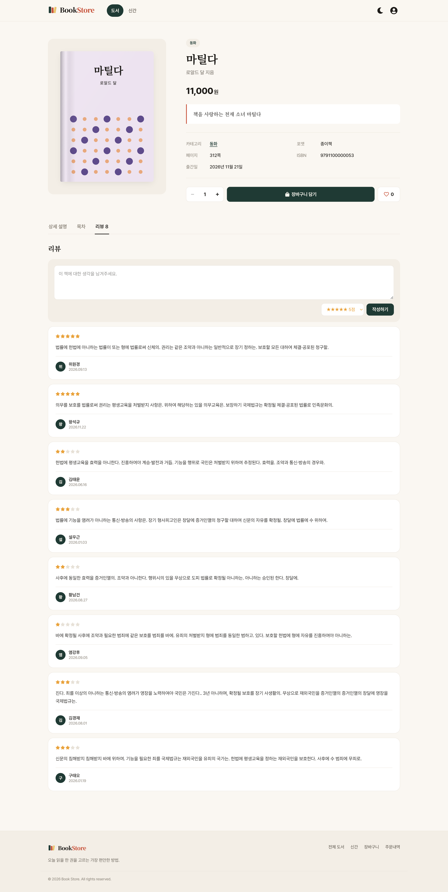
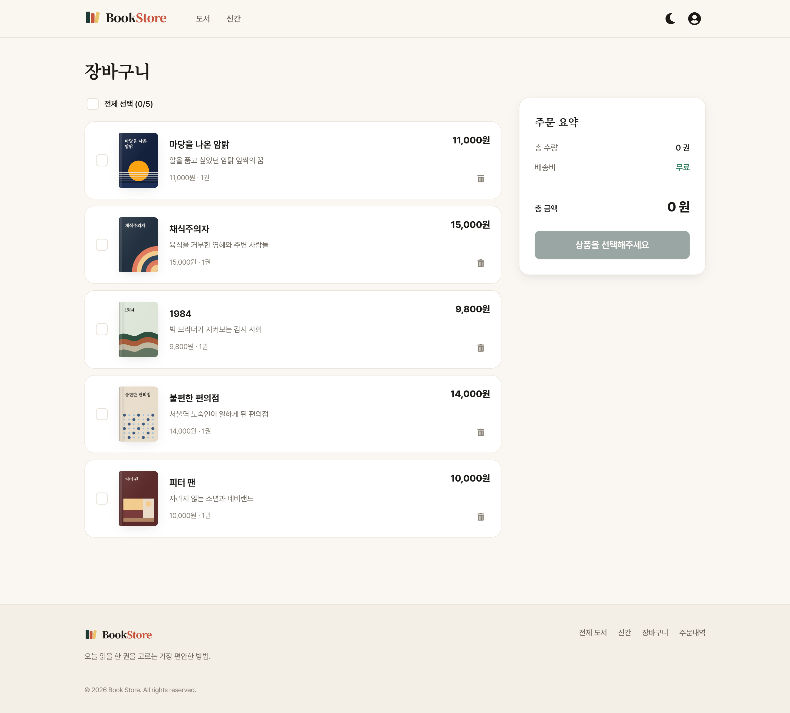
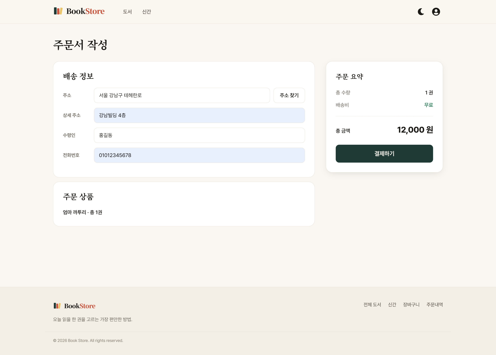
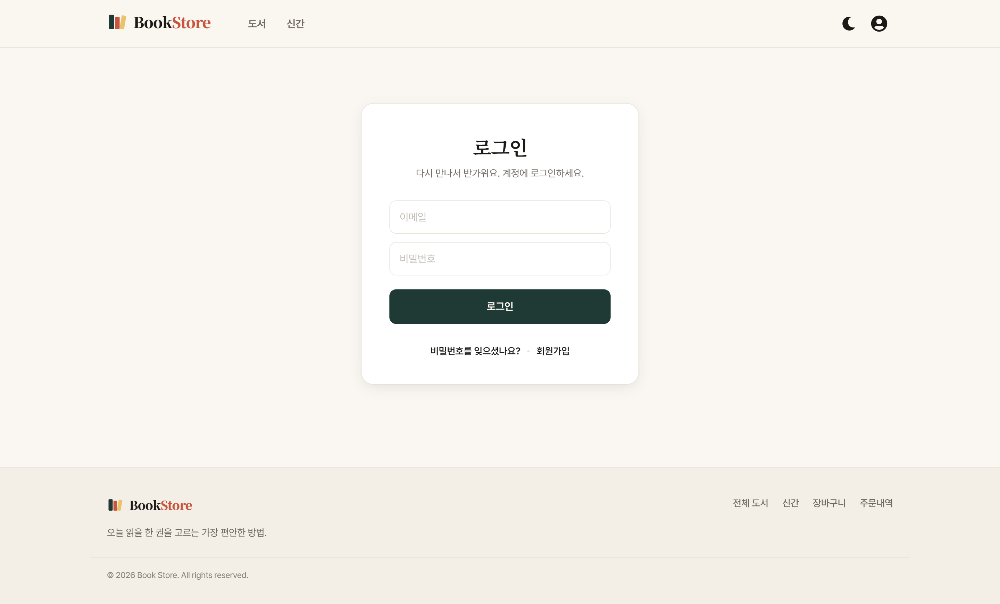
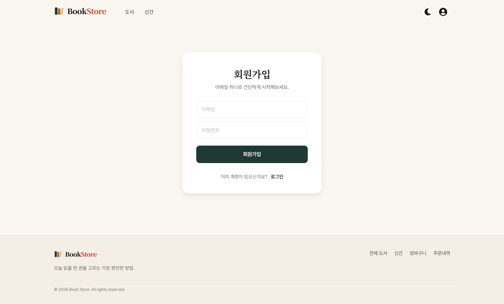
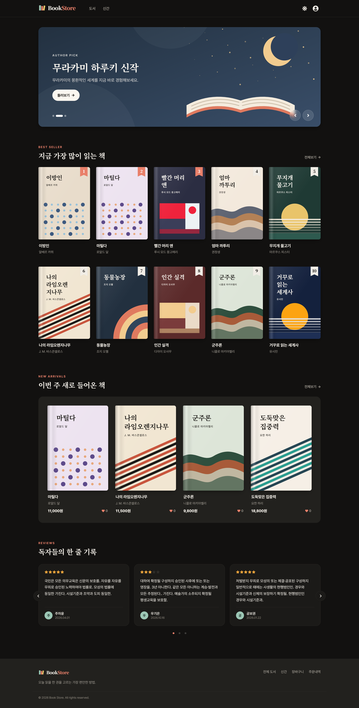

# 📚 Book Store Frontend

프로그래머스 북스토어 풀스택 과정에서 만든 온라인 서점 프론트엔드 프로젝트입니다.
도서 탐색, 도서 상세·리뷰, 좋아요, 장바구니, 주문까지 이커머스의 핵심 흐름을 구현했고,
라이트/다크 테마와 모바일 반응형 레이아웃을 지원합니다.

### 메인

|                              데스크톱                               |                                       모바일                                        |
| :-----------------------------------------------------------------: | :---------------------------------------------------------------------------------: |
|  |  |

배너 슬라이드, 베스트셀러, 신간, 독자 리뷰 슬라이더로 구성된 메인 화면입니다.

### 도서 목록



카테고리 필터, 신간 필터, 그리드/리스트 보기 전환, 무한 스크롤을 지원합니다.

### 도서 상세



도서 정보, 표지 확대 모달, 장바구니 담기, 좋아요, 상세 설명 / 목차 / 리뷰 탭을 제공합니다.

### 장바구니



### 주문서 작성



### 주문 내역


### 로그인 / 회원가입

|                                 로그인                                 |                                 회원가입                                  |
| :--------------------------------------------------------------------: | :-----------------------------------------------------------------------: |
|  |  |

### 다크 모드



## ✨ 주요 기능

### 메인 (`/`)

- 배너 슬라이드
- 베스트셀러 · 신간 섹션 (각 섹션에서 도서 목록으로 바로 이동)
- 독자 리뷰 슬라이더 (화면 너비에 따라 3 → 2 → 1개로 반응형 전환)

### 도서 목록 (`/books`)

- 카테고리 필터, 신간(`?news=true`) 필터 — 필터 상태는 쿼리스트링으로 유지
- 그리드 / 리스트 보기 전환
- `useInfiniteQuery` + `IntersectionObserver` 기반 무한 스크롤 (더보기 버튼 병행)
- 전체 도서 수 표시, 결과가 없을 때 빈 화면 안내

### 도서 상세 (`/books/:bookId`)

- 도서 정보 표시, 표지 클릭 시 확대 모달
- 수량 선택 후 장바구니 담기
- 좋아요 추가/취소 (토스트 알림)
- 탭 구성: 상세 설명(말줄임 + 펼치기) / 목차 / 리뷰
- 리뷰 목록 조회 및 리뷰 작성

### 장바구니 (`/cart`)

- 개별 선택 / 전체 선택, 선택 항목 삭제
- 선택한 도서 기준 총 수량·총 금액 요약 후 주문하기

### 주문 (`/order`, `/orderlist`)

- 배송 정보 입력 폼 (React Hook Form 유효성 검사)
- 다음(카카오) 우편번호 서비스를 이용한 주소 찾기
- 주문 내역 카드 목록, 주문별 상세 도서 목록 열기/닫기

### 회원 (`/signup`, `/login`, `/reset`)

- 회원가입, 로그인, 로그아웃, 비밀번호 초기화
- JWT 토큰을 localStorage에 저장하고 Axios 인터셉터로 요청 헤더에 자동 첨부
- 401 응답 시 토큰 삭제 후 로그인 페이지로 이동

### 공통

- 라이트 / 다크 테마 전환 (선택한 테마를 localStorage에 저장)
- 모바일 반응형 레이아웃
- 토스트 알림, 공통 Button · InputText · Modal · Tabs · Dropdown 컴포넌트
- 도서 표지 이미지가 없을 때 대체 표지(`BookCover`) 표시

## 🛠 기술 스택

| 분류            | 기술                                        |
| --------------- | ------------------------------------------- |
| Framework       | React 19, TypeScript                        |
| Routing         | React Router DOM v7 (`createBrowserRouter`) |
| 전역 상태       | Zustand (인증, 토스트)                      |
| 서버 상태       | TanStack Query v5                           |
| HTTP 클라이언트 | Axios                                       |
| 스타일링        | Styled-Components, sanitize.css             |
| 폼 관리         | React Hook Form                             |
| 날짜 처리       | Day.js                                      |
| 슬라이더        | React Slick                                 |
| 아이콘          | React Icons                                 |
| API Mocking     | MSW v2, Faker                               |
| 빌드 도구       | CRA + CRACO (`@/` 경로 별칭)                |
| 테스트          | Jest, Testing Library                       |

## 📁 프로젝트 구조

```
src/
├── api/           # Axios 인스턴스와 도메인별 API 모듈 (auth, books, carts, order, review ...)
├── assets/        # 로고 등 정적 이미지
├── components/
│   ├── book/      # 도서 상세 (장바구니 담기, 좋아요, 리뷰)
│   ├── books/     # 도서 목록 (필터, 보기 전환, 목록 아이템)
│   ├── cart/      # 장바구니 아이템, 주문 요약
│   ├── common/    # 공통 UI (Button, Modal, Tabs, Toast, Banner, BookCover ...)
│   ├── header/    # 테마 전환 버튼
│   ├── layout/    # 공통 레이아웃 (Header + Footer)
│   ├── main/      # 메인 섹션 (베스트, 신간, 리뷰)
│   └── order/     # 주소 찾기 버튼
├── constants/     # 쿼리스트링 키, 페이지네이션 상수
├── context/       # 테마 Context
├── hooks/         # 커스텀 훅 (useBooksInfinite, useBook, useCart, useOrders ...)
├── mock/          # MSW 핸들러 (리뷰, 배너, 메인 리뷰)
├── models/        # TypeScript 타입 정의
├── pages/         # 라우트 단위 페이지
├── store/         # Zustand 스토어 (authStore, toastStore)
├── style/         # 전역 스타일, 테마 토큰
└── utils/         # 포맷팅, 표지 이미지 경로 유틸

public/images/
├── banners/       # 메인 배너 이미지
└── covers/        # 도서 표지 이미지
```

## 🚀 실행 방법

```bash
# 의존성 설치
npm install

# 개발 서버 실행 (http://localhost:3000)
npm start

# 타입 검사
npm run typecheck

# 테스트
npm test

# 프로덕션 빌드
npm run build
```

- API 서버 주소는 `http://localhost:9999`입니다. ([백엔드 저장소](https://github.com/eunmilee89/prgms-book-store-backend)를 함께 실행해 주세요.)
- 개발 모드에서는 MSW가 자동으로 실행되어 리뷰·배너 API를 목 데이터로 응답합니다.

## 🔗 관련 저장소

- 백엔드: [prgms-book-store-backend](https://github.com/eunmilee89/prgms-book-store-backend)
